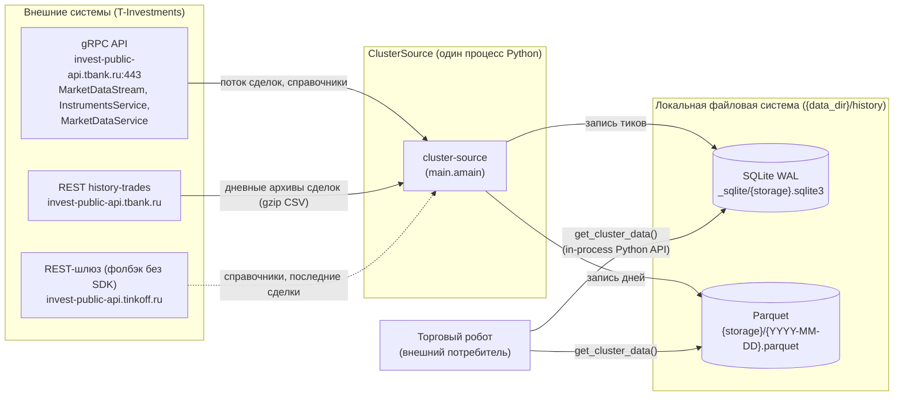

# 1. Обзор системы

## 1.1. Назначение

ClusterSource непрерывно собирает обезличенные сделки по списку инструментов
Московской биржи (акции и фьючерсы) из API T-Investments, хранит их локально
и отдаёт торговому роботу в виде footprint-матрицы (объём покупок/продаж по
уровням цены и интервалам времени).

## 1.2. Контекст

Торговый робот не взаимодействует с процессом ClusterSource по сети: он
импортирует пакет `cluster_source` и читает те же файлы. Параллельное чтение
во время записи обеспечивает режим WAL SQLite.

## 1.3. Возможности

| Возможность | Модуль | Описание |
|-------------|--------|----------|
| Потоковый сбор сделок | `collector.py`, `main.py` | [05-realtime-collection.md](05-realtime-collection.md) |
| Непрерывные фьючерсы | `config.py`, `main.py`, `autoload.py` | [05](05-realtime-collection.md#52-открытие-стрима-и-резолюция-инструмента), [06](06-history-backfill.md#66-ключи-архива-и-непрерывные-фьючерсы) |
| Догрузка пропущенных и перекачка неполных дней | `autoload.py` | [06-history-backfill.md](06-history-backfill.md) |
| Архивация SQLite → Parquet, ночное обслуживание | `archiver.py`, `main.py` | [07-archiving.md](07-archiving.md) |
| Footprint для робота | `reader.py` | [08-footprint-reader.md](08-footprint-reader.md) |
| Корректное завершение | `main.py`, `collector.py` | [02-architecture.md](02-architecture.md#25-жизненный-цикл-процесса) |

## 1.4. Границы системы (что система НЕ делает)

- Не выставляет заявки и не работает со счетами.
- Не предоставляет собственного сетевого API (HTTP/gRPC); единственный
  интерфейс для потребителя — Python-функция `get_cluster_data()`.
- Не собирает стаканы, свечи, последние цены — только сделки.
- Работает в одном процессе и на одном хосте; распределённый режим не
  предусмотрен.

## 1.5. Технологический стек

| Компонент | Технология | Версия (pyproject) | Назначение |
|-----------|------------|--------------------|------------|
| Язык | Python | ≥ 3.11 (mypy — 3.13) | — |
| Асинхронность | `asyncio` | stdlib | event loop, очереди, задачи |
| SDK брокера | `t-tech-investments` (модуль `t_tech`) | ≥ 1.49, < 2.0, опционально | gRPC: стрим сделок, справочники |
| HTTP-клиент | `aiohttp` | ≥ 3.9 | `history-trades`, REST-фолбэки |
| TLS | `truststore`, `certifi` | ≥ 0.8 / ≥ 2024.2 | системное хранилище CA, фолбэк |
| Горячее хранилище | SQLite (`sqlite3`) | stdlib | WAL, 7 дней |
| Холодное хранилище | Parquet (`pyarrow`) | ≥ 14.0 | snappy, 1 файл/день |
| Обработка данных | `pandas` | ≥ 2.0 | чтение, группировка footprint |
| Конфигурация | `pyyaml` | ≥ 6.0 | `config.yaml` |
