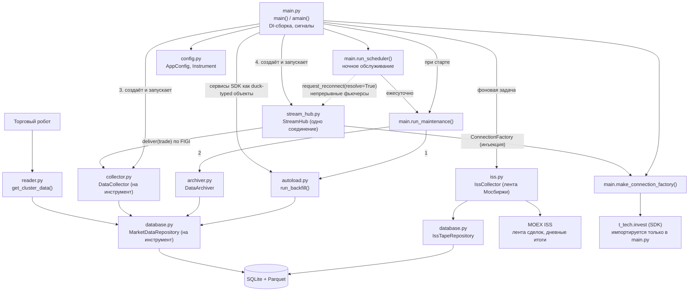
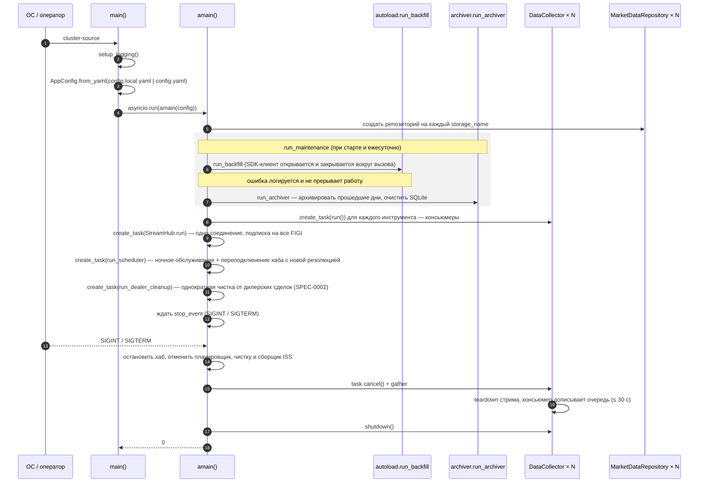

# 2. Архитектура

## 2.1. Компоненты

## 2.2. Модули

| Модуль | Ключевые объекты | Ответственность | Зависит от |
|--------|------------------|-----------------|------------|
| `config.py` | `AppConfig`, `BatchConfig`, `ArchiverConfig`, `Instrument`, `InstrumentType`, `Direction`, `FuturesMeta`, `nearest_contract`, `parse_direction` | Разбор `config.yaml`, доменная модель: правило `storage_name`, выбор активного контракта, нормализация направления | `pyyaml` |
| `database.py` | `MarketDataRepository`, `IssTapeRepository`, `DataCorruptionError`, `HOT_RETENTION_DAYS = 7` | Единственная точка доступа к SQLite и Parquet: тики инструментов и лента Мосбиржи | `config`, `pandas`, `pyarrow`, `sqlite3` |
| `iss.py` | `IssCollector`, `HttpIssClient`, `normalize_trades`, `trade_time_utc` | Сбор ленты Мосбиржи из ISS, смена дня, импорт этапа 1, проверка полноты ([SPEC-0003](specs/0003-iss-collection.md)) | `config`, `database`, `autoload._ssl_context`, `aiohttp` |
| `collector.py` | `DataCollector`, `Tick`, `InstrumentNotFound`, `_to_dto` | Приём сделок инструмента (Producer `deliver`) и пакетная запись (Consumer), отметки неполных дней | `config`, `database` |
| `reconcile.py` | `Reconciler`, `reconcile_minute`, `MinuteResult` | Сверка стрима с лентой ISS, дозаливка, вердикты минут ([SPEC-0005](specs/0005-iss-reconciliation.md)) | `config`, `database`, `quality` |
| `quality.py` | `InstrumentQuality`, причины `REASON_*`, `is_normal_trading`, `minutes_between` | Условия деградации и отметки минут инструмента ([SPEC-0004](specs/0004-degradation-detectors.md)) | — |
| `stream_hub.py` | `StreamHub`, `HubConnection`, `ConnectionFactory`, `subscription_ok` | Одно стрим-соединение на все инструменты: подписка, раздача сделок по FIGI, проверка подтверждений, переподключение ([SPEC-0009](specs/0009-single-market-data-stream.md)) | `collector`, `config` |
| `autoload.py` | `run_backfill`, `missing_days`, `refresh_days`, `backfill_day`, `BackfillResult`, `_RateGate` | Догрузка отсутствующих и перекачка отмеченных дней | `config`, `database`, `aiohttp`, `truststore` |
| `archiver.py` | `DataArchiver`, `run_archiver`, `seconds_until_next_run` | Перенос прошедших дней в Parquet, очистка SQLite, расчёт расписания | `config`, `database` |
| `reader.py` | `get_cluster_data` | Footprint-матрица для робота | `config`, `database`, `pandas` |
| `main.py` | `main`, `amain`, `run_maintenance`, `run_scheduler`, `make_connection_factory`, `build_trades_subscription`, `_resolve_figis`, `_resolve_stream_figi` | Точка входа, DI-сборка, ночное обслуживание, сигналы, работа с SDK | все модули, SDK (опционально) |

## 2.3. Внедрение зависимостей

Глобального состояния нет: все зависимости передаются через конструкторы и
параметры функций.

| Потребитель | Что внедряется | Кем создаётся |
|-------------|----------------|---------------|
| `MarketDataRepository(repo_path, instrument)` | `AppConfig.storage_root`, `Instrument` | `amain` — по одному на `storage_name` |
| `DataCollector(config, instrument, repo)` | `AppConfig`, `Instrument`, репозиторий | `amain` |
| `StreamHub(collectors, factory)` | коллекторы, `ConnectionFactory` | `amain` |
| `ConnectionFactory = Callable[[Sequence[Instrument], bool], Awaitable[HubConnection]]` | `AppConfig` и кэш FIGI (замыкание) | `make_connection_factory(config)` |
| `run_backfill(config, repos, market_data=, instruments=, kind_share=, kind_futures=, futures_status=)` | сервисы SDK и значения enum SDK | `run_maintenance` (если SDK установлен) |
| `run_scheduler(config, job)` | задача обслуживания (`Callable[[], Awaitable[None]]`) | `amain` |
| `DataArchiver(config, repo)` | `AppConfig`, репозиторий | `run_archiver` |
| `get_cluster_data(config, repo, ...)` | `AppConfig`, репозиторий | потребитель (робот) |
| `IssCollector(config, repo, client=, now=, sleep=)` | `AppConfig`, `IssTapeRepository`, клиент ISS (в тестах — заглушка), часы и пауза | `amain`, если `iss.enabled` |

SDK импортируется **только** в `main.py` (флаг `_has_sdk`). Остальные модули
получают объекты SDK как duck-typed параметры, поэтому работают и
тестируются без SDK.

## 2.4. Модель конкурентности

- Один процесс, один event loop (`asyncio.run(amain(config))`).
- Одна задача `StreamHub.run()` держит **одно** стрим-соединение T-Invest
  (лимит аккаунта — 32 соединения по тарифу, 16 на грейдах 1–4 по
  документации) и раздаёт сделки; на каждый инструмент — задача
  `DataCollector.run()` с консьюмером; плюс задачи планировщика ночного
  обслуживания, чистки от дилерских сделок и сборщика ленты ISS.
- Блокирующий I/O к SQLite/Parquet выполняется в пуле потоков через
  `asyncio.to_thread`; каждое обращение открывает собственное подключение
  (`MarketDataRepository.session()`), поэтому подключения не разделяются
  между потоками.
- Догрузка: до 4 одновременных задач (`MAX_BACKFILL_CONCURRENCY`) и
  глобальный ограничитель темпа запросов к архиву (`_RateGate`,
  интервал `60/28 ≈ 2,14 с`).

## 2.5. Жизненный цикл процесса

Корректное завершение гарантирует запись накопленных тиков при отмене в
любом состоянии коллектора: дренаж очереди выполняется в `finally`.

## 2.6. Архитектурные инварианты

| № | Правило | Как обеспечивается | Где |
|---|---------|--------------------|-----|
| A1 | Нет сырого SQL вне репозитория | Весь SQL — внутри репозиториев `database.py` (`MarketDataRepository`, `IssTapeRepository`); остальные модули вызывают их методы | `database.py` |
| A2 | Нет записи в БД из gRPC-потока | Продюсер только кладёт `Tick` в `asyncio.Queue` и копит отметки дней в памяти; пишет консьюмер | `collector.py` |
| A3 | Пакетная запись в одной транзакции | `insert_ticks`: `BEGIN` → `executemany` → `COMMIT`/`ROLLBACK` | `database.py` |
| A4 | WAL обязателен | `session()` выполняет `PRAGMA journal_mode=WAL` при каждом подключении | `database.py` |
| A5 | DI вместо глобальных объектов | Конфигурация, репозитории, фабрика стрима, сервисы SDK — через параметры | все модули |
| A6 | SDK только в `main.py` | Опциональный импорт с флагом `_has_sdk` | `main.py` |
| A7 | Только UTC | `_iso()` приводит время к UTC и всегда пишет микросекунды; чтение — `pd.to_datetime(utc=True, format="ISO8601")` | `database.py`, `autoload.py`, `collector.py` |
| A8 | Строки SQLite удаляются только для дней, у которых есть проверенный Parquet | `write_parquet` бросает `DataCorruptionError`; перед очисткой `run_once` сверяет дни SQLite раньше `cutoff` с Parquet | `archiver.py` |
| A9 | Граница очистки совпадает с маршрутизацией догрузки | `_hot_purge_cutoff()` и `_target_for_day()` используют одну границу `today − 7` | `archiver.py`, `autoload.py` |
| A11 | Одно правило выбора контракта непрерывного фьючерса | `config.nearest_contract` используют и стрим, и догрузка | `config.py`, `main.py`, `autoload.py` |
| A14 | Лента ISS без дублей, конец ленты — только по последней сделке | Ключ `UNIQUE(market, secid, tradeno)`; пустая страница ISS сверяется с `reversed=1` ([SPEC-0003](specs/0003-iss-collection.md)) | `database.py`, `iss.py` |
| A12 | В хранилище только биржевые сделки | Подписка и REST `GetLastTrades` запрашивают `TRADE_SOURCE_EXCHANGE`; ответы SDK, архива и стрима фильтруются `config.is_exchange_trade` ([SPEC-0002](specs/0002-exchange-only-trades.md)) | `main.py`, `collector.py`, `autoload.py` |
| A17 | Сверка только добавляет | Секунда заменяется сделками ISS, только если наши — их подмножество; иначе `GAP` без изменений; минута — одна транзакция ([SPEC-0005](specs/0005-iss-reconciliation.md)) | `reconcile.py`, `database.py` |
| A16 | Деградация видна в данных | Детекторы помечают минуты `DEGRADED` не реже раза в 5 с; отметки и переходы пишет консьюмер (A2); тишина вне `NORMAL_TRADING` не деградация ([SPEC-0004](specs/0004-degradation-detectors.md)) | `quality.py`, `stream_hub.py`, `collector.py` |
| A15 | Одно стрим-соединение на процесс | Все подписки на сделки — в соединении `StreamHub` (≤ 300 подписок); FIGI разрешаются только при старте и ролловере ([SPEC-0009](specs/0009-single-market-data-stream.md)) | `stream_hub.py`, `main.py` |
| A13 | Перекачка дня не пересекается с архивацией | Обслуживание держит `maintenance_lock` весь прогон, фоновая чистка — на каждый день; один `archive_gate()` на процесс | `main.py`, `autoload.py` |
| A10 | TLS-проверка всегда включена | `_ssl_context()` — `truststore`, фолбэк `certifi`; без `_create_unverified_context` | `autoload.py` |

## 2.7. Обработка ошибок

| Ситуация | Компонент | Реакция |
|----------|-----------|---------|
| Тикер не найден (`InstrumentNotFound`) | `make_connection_factory` | Предупреждение `Инструмент X не найден у провайдера`; инструмент не входит в подписку до следующей резолюции |
| Ошибка открытия соединения (сеть, gRPC, резолюция) | `StreamHub.run` | SDK-клиент закрывается; повтор с экспоненциальной задержкой 2 → 4 → … → 60 с; FIGI разрешаются заново, пока не получится |
| Ошибка/закрытие стрима во время чтения | `StreamHub.run` | `teardown`, повтор с той же задержкой без новой резолюции FIGI; сброс после 60 с стабильной работы; `stream_gap` у всех инструментов |
| Подписка инструмента не подтверждена | `StreamHub._check_subscriptions` | ERROR `STREAM_SUBSCRIPTION_FAILED`, отметка `stream_gap` |
| Ошибка записи пакета | `DataCollector._consumer` | Лог `Ошибка флаша консьюмера`, пакет **отбрасывается** |
| Ошибка записи отметок дней | `DataCollector._consumer` | Лог, отметки возвращаются в память и пишутся при следующей записи |
| Любая ошибка догрузки | `run_maintenance` | Лог `Ошибка автозагрузки`, работа продолжается |
| Parquet не создан или пуст | `DataArchiver` | Лог `АРХИВАЦИЯ НЕ УДАЛАСЬ`; если день старше `cutoff` — очистка SQLite отменяется целиком |
| HTTP 429 от архива | `_backfill_from_archive` | До 3 попыток, пауза `Retry-After` (по умолчанию 60 с) |
| Ошибка чтения Parquet-файла | `read_parquet` | Предупреждение, файл пропускается |
