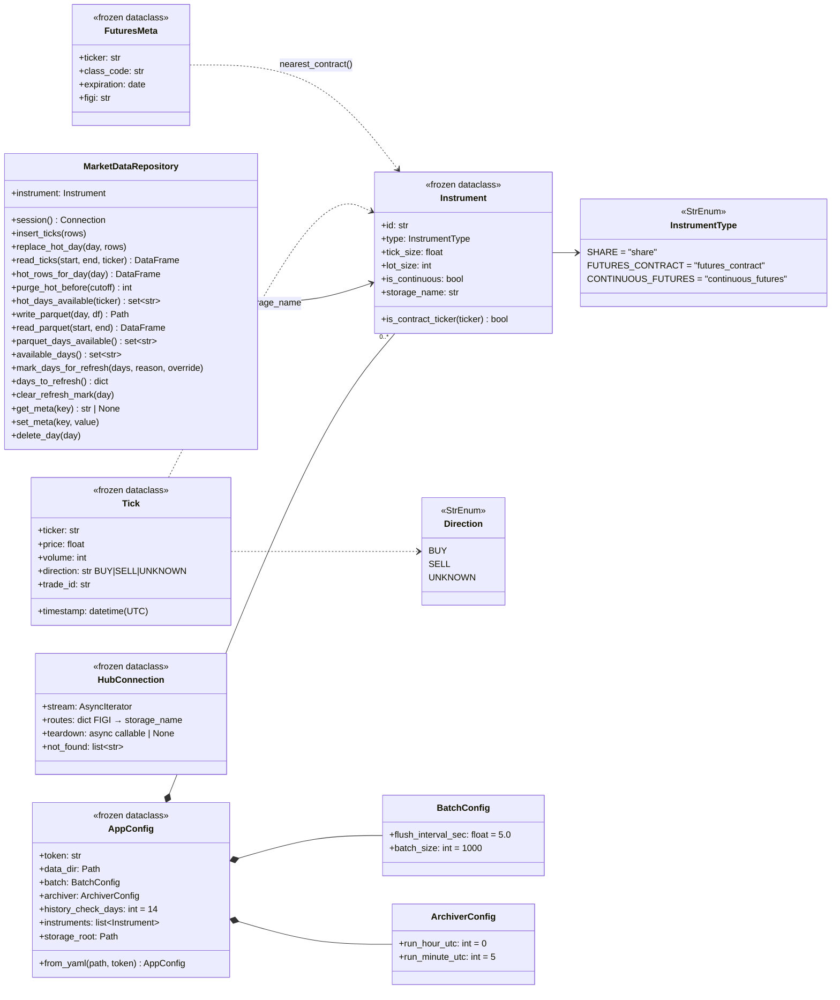

# 3. Модель данных

## 3.1. Доменные классы



### 3.1.1. Instrument

| Поле | Тип | Назначение | Где используется |
|------|-----|------------|------------------|
| `id` | `str` | Тикер (`SBER`) или префикс фьючерса (`Si`) | резолюция FIGI, ключ архива |
| `type` | `InstrumentType` | Способ резолюции и хранения | везде |
| `tick_size` | `float` | Шаг цены | округление цены в `get_cluster_data` |
| `lot_size` | `int` | Размер лота | справочное поле ([L-09](12-known-issues.md#l-09)) |
| `storage_name` | `str` (вычисляемое) | Ключ хранения | пути файлов, колонка `ticker` |
| `is_contract_ticker(t)` | метод | `t` соответствует `^{id}[FGHJKMNQUVXZ]\d{1,2}$` | выбор контракта непрерывного фьючерса |

Правило `storage_name`:

| `type` | `storage_name` | Пример |
|--------|----------------|--------|
| `share` | `id` | `SBER` → `SBER` |
| `futures_contract` | `id` | `SiZ6` → `SiZ6` |
| `continuous_futures` | `{id}_CONTINUOUS` | `Si` → `Si_CONTINUOUS` |

### 3.1.2. Tick

Единица данных во всех хранилищах. JSON Schema:
[contracts/schemas/tick.schema.json](contracts/schemas/tick.schema.json).

| Поле | Тип | Ограничения | Смысл |
|------|-----|-------------|-------|
| `ticker` | `str` | = `Instrument.storage_name` | Ключ хранения |
| `timestamp` | `datetime` | tz-aware, UTC, точность до микросекунд | Время сделки |
| `price` | `float` | > 0 (не проверяется) | Цена в валюте/пунктах инструмента, без округления |
| `volume` | `int` | ≥ 0 | Количество в лотах |
| `direction` | `str` | `BUY` \| `SELL` \| `UNKNOWN` | Направление агрессора; `UNKNOWN` — нет агрессора или не указано |
| `trade_id` | `str` | непустая строка | Идентификатор сделки (см. 3.4) |

## 3.2. Раскладка хранилища

```
{data_dir}/history/                      # AppConfig.storage_root
├── _sqlite/
│   ├── SBER.sqlite3                     # горячее хранилище (+ -wal, -shm)
│   ├── Si_CONTINUOUS.sqlite3
│   └── _iss.sqlite3                     # лента Мосбиржи текущего дня (SPEC-0003)
├── _iss/
│   ├── shares/2026-10-12.parquet        # лента рынка акций, 1 файл = 1 лента ISS (feed_date, МСК)
│   └── forts/2026-10-12.parquet         # лента FORTS
├── _iss_raw/                            # необязательно: сырые файлы ленты ISS для ручного импорта
├── SBER/
│   ├── 2026-09-03.parquet               # холодное хранилище, 1 файл = 1 день UTC
│   └── 2026-09-04.parquet
└── Si_CONTINUOUS/
    └── 2026-09-04.parquet
```

Каждый инструмент — отдельный SQLite-файл и отдельный каталог Parquet;
между инструментами общих файлов нет. Лента Мосбиржи — общая для всего
рынка (3.7).

## 3.3. Форматы хранения

### 3.3.1. SQLite (горячее хранилище)

```sql
CREATE TABLE IF NOT EXISTS ticks_hot_store (
    ticker     TEXT NOT NULL,
    timestamp  DATETIME NOT NULL,
    price      REAL NOT NULL,
    volume     INTEGER NOT NULL,
    direction  TEXT NOT NULL,
    trade_id   TEXT NOT NULL
);
CREATE INDEX IF NOT EXISTS idx_ticks_ticker_ts ON ticks_hot_store (ticker, timestamp);

CREATE TABLE IF NOT EXISTS days_to_refresh (
    day        TEXT PRIMARY KEY,   -- YYYY-MM-DD, UTC
    reason     TEXT NOT NULL,      -- stream_gap | compromised | partial_backfill | dealer_cleanup
    marked_at  TEXT NOT NULL       -- ISO 8601, UTC
);

CREATE TABLE IF NOT EXISTS meta (
    key    TEXT PRIMARY KEY,       -- например spec0002_dealer_cleanup_scheduled
    value  TEXT NOT NULL
);
```

В `ticks_hot_store` нет первичного ключа и ограничения уникальности:
реальные сделки могут совпадать по всем полям (см. [L-05](12-known-issues.md#l-05)).
Пересечение SQLite и Parquet по дню разрешается при чтении выбором одного
источника ([8.3](08-footprint-reader.md#83-алгоритм)).

`days_to_refresh` — отметки неполных дней для перекачки из архива
([6.3](06-history-backfill.md#63-отметки-для-перекачки)). Повторная отметка
дня не меняет первую причину (`INSERT OR IGNORE`), кроме `override=True`
(`INSERT OR REPLACE`, используется чисткой `dealer_cleanup`).

`meta` — служебные флаги однократных операций обслуживания.

Качество данных ([SPEC-0004](specs/0004-degradation-detectors.md)):

```sql
CREATE TABLE IF NOT EXISTS degraded_minutes (
    minute  TEXT NOT NULL,          -- начало минуты, ISO UTC
    reason  TEXT NOT NULL,          -- stream_gap | stream_silence | latency | …
    PRIMARY KEY (minute, reason)
);
CREATE TABLE IF NOT EXISTS quality_events (
    ts       TEXT NOT NULL,         -- момент перехода, ISO UTC
    state    TEXT NOT NULL,         -- DEGRADED | OK
    reasons  TEXT NOT NULL          -- активные причины через запятую
);
```

Хранятся только минуты с отметками; остальные — `PROVISIONAL`. Последняя
строка `quality_events` — текущее состояние инструмента.

Сверка с лентой Мосбиржи ([SPEC-0005](specs/0005-iss-reconciliation.md)):

```sql
-- колонки ticks_hot_store (миграция старых баз при открытии)
origin             TEXT NOT NULL DEFAULT 'stream'  -- stream | iss | archive
exchange_trade_no  INTEGER                         -- TRADENO биржи после сверки

CREATE TABLE IF NOT EXISTS minute_verdicts (
    minute    TEXT PRIMARY KEY,   -- начало минуты, ISO UTC
    status    TEXT NOT NULL,      -- VERIFIED | REPAIRED | GAP
    stream_n  INTEGER NOT NULL,   -- сделок стрима до сверки
    iss_n     INTEGER NOT NULL,   -- сделок ISS
    repaired  INTEGER NOT NULL,   -- заменено секунд
    detail    TEXT NOT NULL
);
```

Курсор сверки — `meta.recon_verified_until` (всё раньше — сверено). Минуты
без сделок вердикта не имеют.

Окончательный статус торгового дня ([SPEC-0006](specs/0006-final-day.md)):

```sql
CREATE TABLE IF NOT EXISTS day_verdicts (
    trade_date   TEXT PRIMARY KEY,  -- торговый день биржи
    status       TEXT NOT NULL,     -- FINAL | ARCHIVE_CONSISTENT | MISMATCH | UNVERIFIABLE
    ours_n       INTEGER NOT NULL,
    ref_n        INTEGER NOT NULL,
    ours_volume  REAL NOT NULL,     -- в единицах эталона (акции — штуки)
    ref_volume   REAL NOT NULL,
    reference    TEXT NOT NULL,     -- iss_totals | iss_tape | none
    detail       TEXT NOT NULL,
    checked_at   TEXT NOT NULL
);
```

В `_iss.sqlite3` — кэш дневных итогов ISS: `iss_day_totals (market,
trade_date, secid, numtrades, volume)` и `iss_trading_dates (market,
trade_date, trading)`; пустой ответ кэшируется как неторговая дата, только
когда итоги точно вышли (через 3 суток).

В хранилище только биржевые сделки
([SPEC-0002](specs/0002-exchange-only-trades.md)): источник сделки
проверяется до записи и отдельной колонкой не хранится.

| PRAGMA | Значение | Зачем |
|--------|----------|-------|
| `journal_mode` | `WAL` | робот читает, пока коллектор пишет |
| `synchronous` | `NORMAL` | баланс надёжности и скорости для WAL |
| `busy_timeout` | `15000` мс | ожидание блокировки вместо ошибки |
| `connect(timeout=)` | `30` с | то же на уровне драйвера Python |

Формат `timestamp` — строка ISO 8601 в UTC, всегда с микросекундами и
смещением `+00:00` (`isoformat(timespec="microseconds")`), например
`2026-09-04T10:00:00.000000+00:00`. Строки, записанные до унификации
формата, могут быть без дробной части; при чтении используется
`format="ISO8601"`, поэтому оба варианта разбираются
([L-10](12-known-issues.md#l-10)). Фильтрация по времени — лексикографическое
сравнение строк (порядок верен для обоих вариантов); день извлекается как
`substr(timestamp, 1, 10)`.

### 3.3.2. Parquet (холодное хранилище)

Путь `{storage_root}/{storage_name}/{YYYY-MM-DD}.parquet`, сжатие `snappy`,
без индекса pandas. Файл перезаписывается целиком при повторной записи дня.

| Колонка | Логический тип Arrow | Примечание |
|---------|----------------------|------------|
| `ticker` | `string` / `large_string` | физический тип зависит от версии pandas |
| `timestamp` | `timestamp[us\|ns, tz=UTC]` | единица зависит от источника и версии pandas |
| `price` | `double` | |
| `volume` | `int64` | |
| `direction` | `string` / `large_string` | `BUY` \| `SELL` \| `UNKNOWN` |
| `trade_id` | `string` / `large_string` | |

Читатели обязаны принимать оба варианта физических типов.

## 3.4. Идентификаторы сделок

| Источник | Формат `trade_id` | Пример | Числовая проверка разрыва |
|----------|-------------------|--------|---------------------------|
| Стрим, легаси SDK `tinkoff-investments` (`trade_id`/`tradeId`) | десятичное число | `123456789` | выполняется |
| Стрим, `t-tech-investments` (поля нет) | `s{YYYYmmddHHMMSSffffff}` | `s20260904100000123456` | пропускается |
| Архив `history-trades` (поля нет) | `s{YYYYmmddHHMMSSffffff}_{idx}`, `idx` — номер строки в файле | `s20260904035935341871_0` | не применяется |
| `GetLastTrades` | значение `trade_id`/`tradeId`, иначе пустая строка | `""` | не применяется |

Синтетические идентификаторы не гарантируют уникальность (две сделки в одну
микросекунду из стрима получают одинаковый `trade_id`,
[L-05](12-known-issues.md#l-05)), поэтому `trade_id` не используется как ключ.

## 3.5. Маппинг между представлениями тика

| `Tick` (Python) | `dict` для `insert_ticks` | SQLite `ticks_hot_store` | Parquet | `DataFrame` после чтения |
|-----------------|---------------------------|--------------------------|---------|--------------------------|
| `ticker: str` | `"ticker"` | `ticker TEXT` | `ticker` string | `ticker` str |
| `timestamp: datetime` (UTC) | `"timestamp"` | `timestamp DATETIME` — ISO-строка с микросекундами через `_iso()` | `timestamp` timestamp[tz=UTC] | `timestamp` `datetime64[*, UTC]` |
| `price: float` | `"price"` | `price REAL` через `_as_float` | `price` double | `price` float64 |
| `volume: int` | `"volume"` | `volume INTEGER` через `_as_int` | `volume` int64 | `volume` int64 |
| `direction: str` | `"direction"` | `direction TEXT` | `direction` string | `direction` str |
| `trade_id: str` | `"trade_id"` | `trade_id TEXT` через `str()` | `trade_id` string | `trade_id` str |

Преобразование `Tick → dict` — `collector._tick_to_dict`; путь
SQLite → Parquet — `hot_rows_for_day` → `write_parquet` без изменения колонок.

## 3.6. Какое хранилище содержит день

Пусть `today` — полночь текущих суток UTC.

| Возраст дня `D` | Куда пишет коллектор | Куда пишет догрузка (`_target_for_day`) | После архивации |
|-----------------|----------------------|-----------------------------------------|-----------------|
| `D = today` | SQLite | SQLite (`GetLastTrades`) | SQLite |
| `today − 7 ≤ D ≤ today − 1` | SQLite | SQLite | SQLite **и** Parquet |
| `D < today − 7` | — | Parquet | Parquet; строки SQLite удаляются |

День считается присутствующим (`available_days`), если есть хотя бы одна
строка в SQLite с `ticker = storage_name` **или** существует Parquet-файл
дня. Неполнота дня отслеживается отдельно — отметками `days_to_refresh`.

## 3.7. Лента Мосбиржи (ISS)

Репозиторий `IssTapeRepository(storage_root)` ([SPEC-0003](specs/0003-iss-collection.md)).
Сделки текущей ленты копятся в `_sqlite/_iss.sqlite3`, после смены дня в ISS
выгружаются в `_iss/{market}/{feed_date}.parquet` (snappy, частями по
200 000 строк, с проверкой числа строк) и удаляются из SQLite.

| Колонка | Тип | Источник ISS | Правило |
|---------|-----|--------------|---------|
| `market` | text | — | `shares` / `forts` |
| `feed_date` | text | `SYSTIME` первой сделки ленты | календарная дата МСК начала ленты |
| `secid` | text | `SECID` | |
| `board` | text | `BOARDID` (акции) / `BOARDNAME` (FORTS) | `TQBR`, `SMAL`, …; `RFUD` |
| `tradeno` | int64 | `TRADENO` | биржевой номер; на фондовом рынке общий для всех бумаг, на FORTS не монотонен |
| `timestamp` | text ISO / `timestamp[us, UTC]` | `TRADETIME` + дата | дата — из `SYSTIME`, если сделка записана вовремя (не раньше чем за час и не позже 5 мин), иначе из `TRADEDATE`; МСК → UTC (`trade_time_utc`) |
| `trade_date` | text | `TRADE_SESSION_DATE` (иначе `TRADEDATE`) | торговый день: сделки сессии выходного дня относятся к следующему |
| `price` | real | `PRICE` | |
| `quantity` | int | `QUANTITY` | |
| `direction` | text | `BUYSELL` | `B` → `BUY`, `S` → `SELL`, иначе `UNKNOWN` |
| `period` | text | `PERIOD` (акции) | `S` — аукцион открытия, `N` — основная торговля, … |
| `session` | text | `TRADINGSESSION` (акции) | `0` утренняя, `1` основная, `2` вечерняя |
| `open_position` | int | `OPENPOSITION` (FORTS) | ОИ после сделки |
| `off_market` | int | `OFFMARKETDEAL` (FORTS) | `1` — внебиржевая адресная сделка |

Ключ уникальности `UNIQUE(market, secid, tradeno)`: повторная загрузка и
импорт сырых файлов не создают дублей.

Служебные таблицы `_iss.sqlite3`:

| Таблица | Назначение |
|---------|------------|
| `iss_feed_state` | ленты рынка: первая сделка (`head`), `feed_date`, сохранено строк (`offset`), курсор `last` (`TRADENO` на акциях, `RECNO` на FORTS), `caught_up` |
| `iss_day_status` | полнота: `kind = feed` (лента догнана до смены дня, G-2) и `kind = trade_date` (сверка с `NUMTRADES`, G-5); `status` — `complete` / `incomplete` / `unverifiable` |
| `iss_meta` | однократные операции, например `raw_imported:{market}:{date}` |
