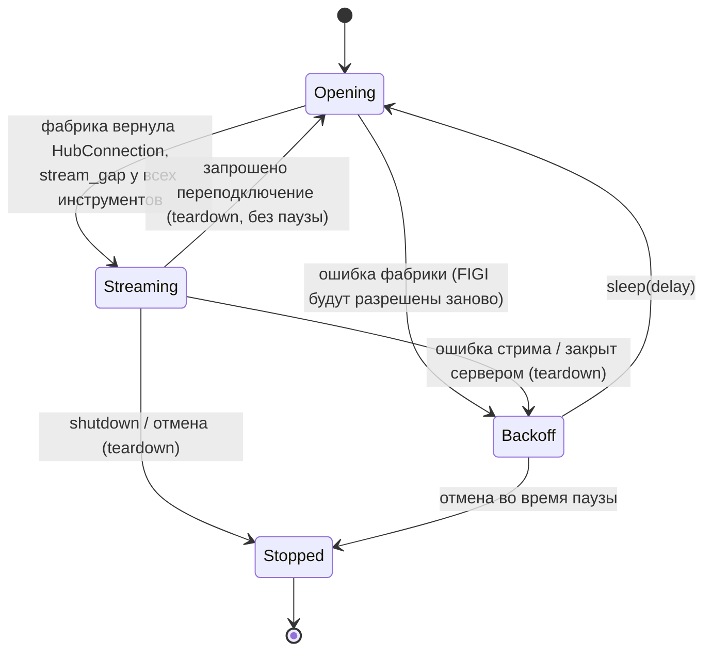

# 5. Сбор тиков в реальном времени

Модули: `stream_hub.py` (`StreamHub`), `collector.py` (`DataCollector`),
`main.py` (`make_connection_factory`, `_resolve_figis`, `_resolve_stream_figi`).
Внешний контракт стрима:
[contracts/asyncapi/t-invest-market-data-stream.asyncapi.yaml](contracts/asyncapi/t-invest-market-data-stream.asyncapi.yaml).

**Одно соединение на все инструменты** ([SPEC-0009](specs/0009-single-market-data-stream.md)).
Лимит T-Invest — 16 активных stream-соединений котировок на грейдах 1–4
(у аккаунта по тарифу — 32), до 300 подписок в одном соединении. Раньше
каждый инструмент открывал своё соединение (56 при лимите 32): сервер
сбрасывал лишние (`RST_STREAM` код 8), сбор шёл по кругу с потерями.

## 5.1. Схема Producer–Consumer

```mermaid
sequenceDiagram
    autonumber
    participant F as ConnectionFactory<br/>(make_connection_factory)
    participant T as T-Invest gRPC<br/>MarketDataStream
    participant H as StreamHub
    participant P as DataCollector.deliver<br/>(продюсер, на инструмент)
    participant Q as asyncio.Queue[Tick]<br/>maxsize = 10000
    participant C as DataCollector._consumer
    participant R as MarketDataRepository

    H->>F: открыть соединение (resolve при старте / ролловере)
    F->>T: AsyncClient + FIGI всех инструментов (кэш)
    F->>T: subscribe(SubscribeTradesRequest: все FIGI, trade_source = EXCHANGE)
    F-->>H: HubConnection(stream, routes FIGI → инструмент)
    H->>P: on_stream_opened() у всех → stream_gap
    loop каждый MarketDataResponse
        T-->>H: MarketDataResponse
        alt subscribe_trades_response
            H->>H: проверить статусы (STREAM_SUBSCRIPTION_FAILED)
        else trade
            H->>P: deliver(trade) по FIGI / instrument_uid
            P->>P: небиржевая → отбросить (DEALER_TRADE_DROPPED)
            P->>P: _to_dto → Tick; разрыв trade_id → compromised
            P->>Q: put(tick) (блокируется при заполненной очереди)
        else ping
            H->>H: пропустить
        end
    end
    loop пока running или очередь не пуста
        C->>Q: get() до дедлайна
        C->>R: to_thread(insert_ticks(batch)) — одна транзакция
        C->>R: to_thread(mark_days_for_refresh(...))
    end
```

Продюсер никогда не обращается к хранилищу (инвариант A2): и тики, и
отметки дней сохраняет консьюмер.

## 5.2. Открытие соединения и резолюция инструментов

Фабрика `make_connection_factory(config)` при каждом открытии:

1. Создаёт `AsyncClient(token)`.
2. При первом открытии пишет в лог лимит из тарифа: `Лимит stream-соединений котировок: N (открыто сейчас: M)`.
3. Если запрошена резолюция (старт, ролловер) или кэш пуст — разрешает FIGI
   всех инструментов (`_resolve_figis`): справочник фьючерсов запрашивается
   **один раз** на все, акции — `find_instrument` по каждой. Ненайденные
   инструменты (`InstrumentNotFound`) пропускаются с предупреждением.
4. Открывает `AsyncMarketDataStreamManager` и отправляет **одну** подписку со
   всеми FIGI (`build_trades_subscription`, `trade_source = TRADE_SOURCE_EXCHANGE`,
   [SPEC-0002](specs/0002-exchange-only-trades.md)). Больше 300 инструментов — ошибка конфигурации.
5. Возвращает `HubConnection(stream, routes, teardown, not_found)`;
   `teardown` вызывает `stream.stop()` и закрывает клиент.

При ошибке на шагах 2–4 клиент закрывается, исключение передаётся в
`StreamHub`. Резолюция FIGI при обычном переподключении не повторяется
(SPEC-0009 G-4).

| `type` | Источник FIGI | Правило выбора | Если не найден |
|--------|---------------|----------------|----------------|
| `share` | `instruments.find_instrument(query=id, instrument_kind=INSTRUMENT_TYPE_SHARE)` | Точное совпадение `ticker == id`; среди совпадений приоритет `class_code` `TQBR`, затем `SPBXM`, иначе первое совпадение | пропуск с предупреждением |
| `futures_contract` | справочник `instruments.futures(INSTRUMENT_STATUS_BASE)` | Первый с `ticker == id` | пропуск с предупреждением |
| `continuous_futures` | тот же справочник | `config.nearest_contract(instrument, futures, today)`: тикер по шаблону `{id}{код месяца}{год}`, экспирация ≥ сегодня, минимальная | пропуск с предупреждением |

Шаблон тикера контракта (`Instrument.is_contract_ticker`):
`^{id}[FGHJKMNQUVXZ]\d{1,2}$` — буква месяца экспирации MOEX и одна-две
цифры года. Для `Si` подходят `SiZ6`, `SiH27`, не подходят `SRZ6`, `SILV`.

Активный контракт выбирается при резолюции. Чтобы перейти на новый контракт
после экспирации, ночное обслуживание вызывает
`StreamHub.request_reconnect(resolve=True)` (см. 5.7).

## 5.3. Обработка кадров стрима

| Входной объект | Условие | Действие |
|----------------|---------|----------|
| любой кадр | хаб остановлен или запрошено переподключение | выйти из цикла чтения |
| `subscribe_trades_response` | — | лог `Подписка на сделки подтверждена: N из M`; неуспешный статус → ERROR `STREAM_SUBSCRIPTION_FAILED X (FIGI): статус …` и `stream_gap` у инструмента |
| `trade` | FIGI или `instrument_uid` есть в маршрутах | `DataCollector.deliver(trade)` своего инструмента |
| `trade` | маршрута нет | пропустить; WARNING `Сделка по неподписанному инструменту X` один раз на FIGI |
| ping и прочие кадры | — | пропустить |

В `DataCollector.deliver`:

| Условие | Действие |
|---------|----------|
| `trade.trade_source` явно небиржевой (`DEALER`, `ALL`, …) | отбросить; `dealer_trades_dropped += 1`; WARNING `DEALER_TRADE_DROPPED` на первой и каждой 1000-й (SPEC-0002 G-3) |
| источник `EXCHANGE` или не указан | `_to_dto` → `Tick`, проверка разрыва `trade_id`, `put` в очередь |

## 5.4. Маппинг сделки на `Tick` (`_to_dto`)

| Поле `Tick` | `t-tech-investments` `Trade` | Легаси `tinkoff-investments` | Правило |
|-------------|------------------------------|------------------------------|---------|
| `ticker` | — | — | `instrument.storage_name` (не `Trade.ticker`) |
| `timestamp` | `time: datetime` | `timestamp.seconds`, `timestamp.nanos` | Приоритет у `timestamp`; naive → UTC; `nanos // 1000` → микросекунды; если нет ни одного поля — `datetime.now(UTC)` |
| `price` | `price: Quotation{units, nano}` | `price: float` | `units + nano / 1e9`, иначе `float(price)` |
| `volume` | `quantity: int64` | `quantity` | `int(quantity)`, по умолчанию 0 |
| `direction` | `direction: TradeDirection` | `direction` | `config.parse_direction`, см. таблицу ниже |
| `trade_id` | — (поля нет) | `trade_id` / `tradeId` | Если пусто — `s{YYYYmmddHHMMSSffffff}` от `timestamp` |

Поля `Trade.figi`, `instrument_uid`, `trade_source`, `class_code`, `ticker`
не сохраняются. `trade_source` используется только для отбора (5.3):
источник разбирает `config.parse_trade_source` — `1`/`EXCHANGE`/`TRADE_SOURCE_EXCHANGE`
и неуказанный источник принимаются, любое другое явное значение отбрасывается.

Маппинг направления (`parse_direction`, без учёта регистра; для `IntEnum`
SDK используется числовое значение):

| Исходное значение | `Tick.direction` |
|-------------------|------------------|
| `1`, `BUY`, `TRADE_DIRECTION_BUY` | `BUY` |
| `2`, `SELL`, `TRADE_DIRECTION_SELL` | `SELL` |
| `0` / `TRADE_DIRECTION_UNSPECIFIED`, пусто, любое другое | `UNKNOWN` |

## 5.5. Консьюмер: пакетная запись


| Параметр | Семантика |
|----------|-----------|
| `batch_size` | Запись сразу при накоплении N тиков |
| `flush_interval_sec` | Запись не реже одного раза за интервал; тики видны читателям с задержкой до интервала |

Ошибка записи пакета логируется (`Ошибка флаша консьюмера`), пакет
отбрасывается. Ошибка записи отметок логируется, отметки возвращаются в
память и сохраняются при следующей записи. Остановку консьюмер замечает
не позже чем через `flush_interval_sec` ([L-07](12-known-issues.md#l-07)).

## 5.6. Контроль полноты дня

Коллектор отмечает день текущих суток для перекачки из официального архива
(механизм перекачки — [6.3](06-history-backfill.md#63-отметки-для-перекачки)):

| Причина | Событие | Почему день неполон |
|---------|---------|---------------------|
| `stream_gap` | Соединение открыто (старт, переподключение) — у всех инструментов; подписка инструмента не подтверждена | Сделки до открытия и во время разрыва не получены |
| `compromised` | `trade_id` идут с разрывом: `cur > prev + 1` (оба числовые) | Пропущены сделки в потоке |

При разрыве `trade_id` дополнительно пишется WARNING
`TRADE_ID GAP … — день YYYY-MM-DD помечен COMPROMISED`. Если любой из
идентификаторов нечисловой, проверка пропускается; для SDK
`t-tech-investments` полноту обеспечивает `stream_gap`
([L-04](12-known-issues.md#l-04)). Повторная отметка дня не меняет первую
причину.

## 5.7. Переподключение



Задержка перед повтором: `delay = min(max(delay · 2, 2), 60)`, то есть
2 → 4 → 8 → 16 → 32 → 60 → 60 с. Если соединение проработало не меньше
`STABLE_STREAM_SEC`, задержка перед расчётом сбрасывается в 0, и следующая
пауза равна 2 с.

`StreamHub.request_reconnect(resolve=...)` выставляет флаг; цикл чтения
выходит на следующем кадре стрима (сделка или ping сервера,
[L-08](12-known-issues.md#l-08)), соединение закрывается и сразу открывается
заново; при `resolve=True` FIGI разрешаются заново (ролловер).

Коллекторы останавливаются отдельно: `amain` сначала останавливает хаб, затем
отменяет задачи `DataCollector.run()`, и каждый консьюмер дописывает свою
очередь (не дольше `CONSUMER_DRAIN_TIMEOUT`).

| Константа | Значение | Назначение |
|-----------|----------|------------|
| `RETRY_BASE` | 2,0 с | Минимальная пауза перед повтором |
| `MAX_RETRY_DELAY` | 60,0 с | Потолок экспоненциальной задержки |
| `STABLE_STREAM_SEC` | 60,0 с | Время жизни соединения, после которого задержка сбрасывается |
| `MAX_SUBSCRIPTIONS_PER_STREAM` | 300 | Лимит подписок одного соединения T-Invest |
| `Queue(maxsize)` | 10 000 | Обратное давление на продюсера (общий стрим ждёт заполненную очередь) |
| `CONSUMER_DRAIN_TIMEOUT` | 30 с | Предел дренажа очереди при остановке |

## 5.8. Детекторы деградации (SPEC-0004)

Модуль `quality.py` (`InstrumentQuality`); детекторы — в `StreamHub`
(уровень соединения, сторож раз в `WATCHDOG_SEC` = 5 с) и в `DataCollector`
(уровень инструмента). Спецификация: [SPEC-0004](specs/0004-degradation-detectors.md).

- **Условие** — длящаяся проблема: пока активно, инструмент `DEGRADED`, и
  каждая минута от начала до конца помечается причиной.
- **Разовая отметка** — одна минута, без смены состояния.
- Переходы `OK` ↔ `DEGRADED` пишутся в журнал `quality_events` и в лог
  (`DATA_DEGRADED X: причины`, `DATA_RESTORED X`). Отметки и переходы
  копятся в памяти и сохраняются консьюмером (инвариант A2).

| Причина | Вид | Условие |
|---------|-----|---------|
| `stream_gap` | условие | От старта процесса (с последней сохранённой сделки, не раньше начала суток UTC) или обрыва (с последнего кадра) до подтверждения подписки инструмента или его первой сделки |
| `subscription_failed` | условие | Подписка инструмента не подтверждена (до следующего открытия соединения) |
| `stream_silence` | условие | Статус `NORMAL_TRADING`, а сделок нет дольше порога: 20 × p95 интервалов между последними 200 сделками, в пределах [60, 900] с (меньше 20 интервалов — 900 с). Отсчёт — от последней сделки, перехода в `NORMAL_TRADING` или подтверждения подписки, что позже. Конец — первая сделка |
| `latency` | условие | Медиана `получено − время сделки` за 30 с > 5 с; конец — < 3 с. Для всех инструментов |
| `backlog` | условие | Очередь ≥ 5 000; конец — ≤ 1 000 |
| `write_failure` | условие + минуты пакета | Ошибка записи пакета; до следующей успешной записи |
| `unknown_direction` | разовая | В закрывшейся минуте при `NORMAL_TRADING` ≥ 20 сделок и > 50% без стороны |
| `contract_roll` | разовая | У непрерывного фьючерса сменился FIGI при переподключении |
| `dealer_leak` | разовая | Небиржевая сделка вопреки фильтру |

Торговые статусы приходят в том же соединении: после подписки
`SubscribeInfoRequest` сервер сразу присылает текущий статус каждого
инструмента (лог `Подписка на торговые статусы подтверждена: N из M`).

Сторож также переподключает соединение, если при идущих торгах от сервера
не было ни одного кадра `DEAD_STREAM_SEC` = 180 с (лог `Стрим сделок мёртв`).
