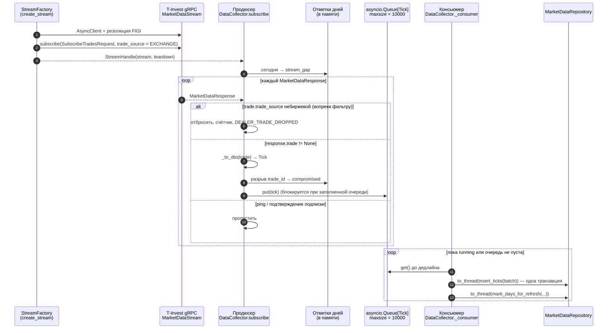
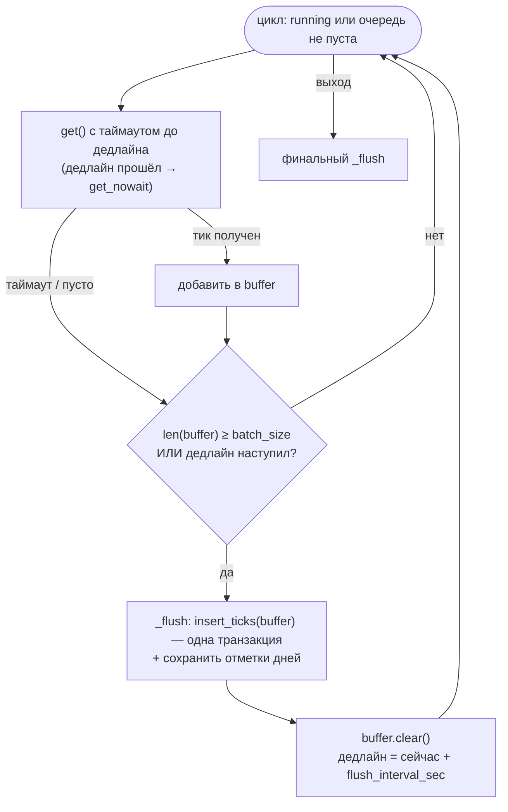
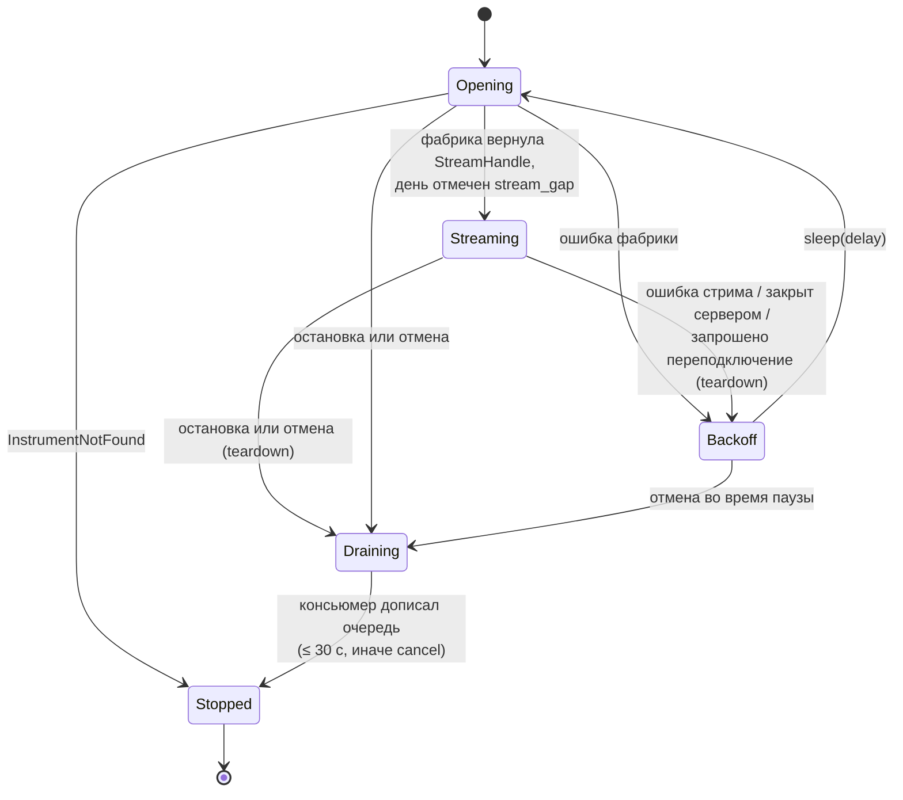

# 5. Сбор тиков в реальном времени

Модули: `collector.py` (`DataCollector`), `main.py` (`create_stream`,
`_resolve_stream_figi`). Внешний контракт стрима:
[contracts/asyncapi/t-invest-market-data-stream.asyncapi.yaml](contracts/asyncapi/t-invest-market-data-stream.asyncapi.yaml).

## 5.1. Схема Producer–Consumer

Продюсер никогда не обращается к хранилищу (инвариант A2): и тики, и
отметки дней сохраняет консьюмер.

## 5.2. Открытие стрима и резолюция инструмента

`create_stream(config, instrument)` выполняется при каждой попытке
подключения:

1. Создаёт `AsyncClient(token)` и входит в его контекст.
2. Определяет FIGI (`_resolve_stream_figi`).
3. Создаёт `AsyncMarketDataStreamManager` и отправляет подписку на сделки
   (`build_trades_subscription`) с `trade_source = TRADE_SOURCE_EXCHANGE`.
   Значение по умолчанию у сервера — `TRADE_SOURCE_ALL`, то есть вместе с
   дилерскими сделками Т-Банка ([SPEC-0002](specs/0002-exchange-only-trades.md)).
4. Возвращает `StreamHandle`; `teardown` вызывает `stream.stop()` и закрывает
   клиент.

При ошибке на шагах 2–3 клиент закрывается, исключение передаётся в
`DataCollector`. Если SDK не установлен, фабрика бросает `RuntimeError`, и
коллектор повторяет попытки с экспоненциальной задержкой.

| `type` | Вызов SDK | Правило выбора | Ошибка при отсутствии |
|--------|-----------|----------------|-----------------------|
| `share` | `instruments.find_instrument(query=id, instrument_kind=INSTRUMENT_TYPE_SHARE)` | Точное совпадение `ticker == id`; среди совпадений приоритет `class_code` `TQBR`, затем `SPBXM`, иначе первое совпадение | `InstrumentNotFound` |
| `futures_contract` | `instruments.futures(instrument_status=INSTRUMENT_STATUS_BASE)` | Первый с `ticker == id` | `InstrumentNotFound` |
| `continuous_futures` | `instruments.futures(instrument_status=INSTRUMENT_STATUS_BASE)` | `config.nearest_contract(instrument, futures, today)`: тикер по шаблону `{id}{код месяца}{год}`, экспирация ≥ сегодня, минимальная | `InstrumentNotFound` |

Шаблон тикера контракта (`Instrument.is_contract_ticker`):
`^{id}[FGHJKMNQUVXZ]\d{1,2}$` — буква месяца экспирации MOEX и одна-две
цифры года. Для `Si` подходят `SiZ6`, `SiH27`, не подходят `SRZ6`, `SILV`.

Активный контракт выбирается при открытии стрима. Чтобы коллектор перешёл
на новый контракт после экспирации, ночное обслуживание запрашивает
переподключение коллекторов непрерывных фьючерсов (см. 5.7).

## 5.3. Обработка кадров стрима

| Входной объект | Условие | Действие |
|----------------|---------|----------|
| любой кадр | коллектор остановлен или запрошено переподключение | выйти из `subscribe` |
| `MarketDataResponse` | `trade is not None`, `trade.trade_source` явно небиржевой (`DEALER`, `ALL`, …) | отбросить; `dealer_trades_dropped += 1`; WARNING `DEALER_TRADE_DROPPED` на первой и каждой 1000-й (SPEC-0002 G-3) |
| `MarketDataResponse` | `trade is not None`, источник `EXCHANGE` или не указан | `payload = response.trade` → `Tick` |
| `MarketDataResponse` | `trade is None` (ping, `subscribe_trades_response`, …) | пропустить |
| Объект без атрибута `trade` | — | считается самой сделкой (легаси SDK, тесты) |

## 5.4. Маппинг сделки на `Tick` (`_to_dto`)

| Поле `Tick` | `t-tech-investments` `Trade` | Легаси `tinkoff-investments` | Правило |
|-------------|------------------------------|------------------------------|---------|
| `ticker` | — | — | `instrument.storage_name` (не `Trade.ticker`) |
| `timestamp` | `time: datetime` | `timestamp.seconds`, `timestamp.nanos` | Приоритет у `timestamp`; naive → UTC; `nanos // 1000` → микросекунды; если нет ни одного поля — `datetime.now(UTC)` |
| `price` | `price: Quotation{units, nano}` | `price: float` | `units + nano / 1e9`, иначе `float(price)` |
| `volume` | `quantity: int64` | `quantity` | `int(quantity)`, по умолчанию 0 |
| `direction` | `direction: TradeDirection` | `direction` | `config.parse_direction`, см. таблицу ниже |
| `trade_id` | — (поля нет) | `trade_id` / `tradeId` | Если пусто — `s{YYYYmmddHHMMSSffffff}` от `timestamp` |

Поля `Trade.figi`, `instrument_uid`, `trade_source`, `class_code`, `ticker`
не сохраняются. `trade_source` используется только для отбора (5.3):
источник разбирает `config.parse_trade_source` — `1`/`EXCHANGE`/`TRADE_SOURCE_EXCHANGE`
и неуказанный источник принимаются, любое другое явное значение отбрасывается.

Маппинг направления (`parse_direction`, без учёта регистра; для `IntEnum`
SDK используется числовое значение):

| Исходное значение | `Tick.direction` |
|-------------------|------------------|
| `1`, `BUY`, `TRADE_DIRECTION_BUY` | `BUY` |
| `2`, `SELL`, `TRADE_DIRECTION_SELL` | `SELL` |
| `0` / `TRADE_DIRECTION_UNSPECIFIED`, пусто, любое другое | `UNKNOWN` |

## 5.5. Консьюмер: пакетная запись

| Параметр | Семантика |
|----------|-----------|
| `batch_size` | Запись сразу при накоплении N тиков |
| `flush_interval_sec` | Запись не реже одного раза за интервал; тики видны читателям с задержкой до интервала |

Ошибка записи пакета логируется (`Ошибка флаша консьюмера`), пакет
отбрасывается. Ошибка записи отметок логируется, отметки возвращаются в
память и сохраняются при следующей записи. Остановку консьюмер замечает
не позже чем через `flush_interval_sec` ([L-07](12-known-issues.md#l-07)).

## 5.6. Контроль полноты дня

Коллектор отмечает день текущих суток для перекачки из официального архива
(механизм перекачки — [6.3](06-history-backfill.md#63-отметки-для-перекачки)):

| Причина | Событие | Почему день неполон |
|---------|---------|---------------------|
| `stream_gap` | Стрим открыт (старт процесса, переподключение) | Сделки до открытия стрима и во время разрыва не получены |
| `compromised` | `trade_id` идут с разрывом: `cur > prev + 1` (оба числовые) | Пропущены сделки в потоке |

При разрыве `trade_id` дополнительно пишется WARNING
`TRADE_ID GAP … — день YYYY-MM-DD помечен COMPROMISED`. Если любой из
идентификаторов нечисловой, проверка пропускается; для SDK
`t-tech-investments` полноту обеспечивает `stream_gap`
([L-04](12-known-issues.md#l-04)). Повторная отметка дня не меняет первую
причину.

## 5.7. Переподключение

Задержка перед повтором: `delay = min(max(delay · 2, 2), 60)`, то есть
2 → 4 → 8 → 16 → 32 → 60 → 60 с. Если стрим проработал не меньше
`STABLE_STREAM_SEC`, задержка перед расчётом сбрасывается в 0, и следующая
пауза равна 2 с.

`DataCollector.request_reconnect()` выставляет флаг; `subscribe` выходит на
следующем кадре стрима (сделка или ping сервера,
[L-08](12-known-issues.md#l-08)), стрим закрывается и открывается заново с
новой резолюцией инструмента.

| Константа | Значение | Назначение |
|-----------|----------|------------|
| `RETRY_BASE` | 2,0 с | Минимальная пауза перед повтором |
| `MAX_RETRY_DELAY` | 60,0 с | Потолок экспоненциальной задержки |
| `STABLE_STREAM_SEC` | 60,0 с | Время жизни стрима, после которого задержка сбрасывается |
| `Queue(maxsize)` | 10 000 | Обратное давление на продюсера |
| `CONSUMER_DRAIN_TIMEOUT` | 30 с | Предел дренажа очереди при остановке |
