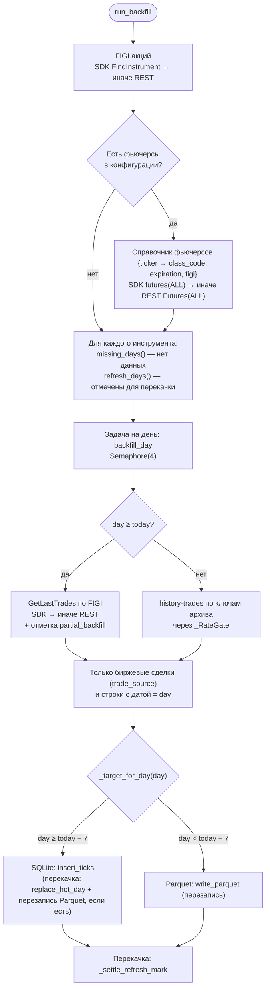
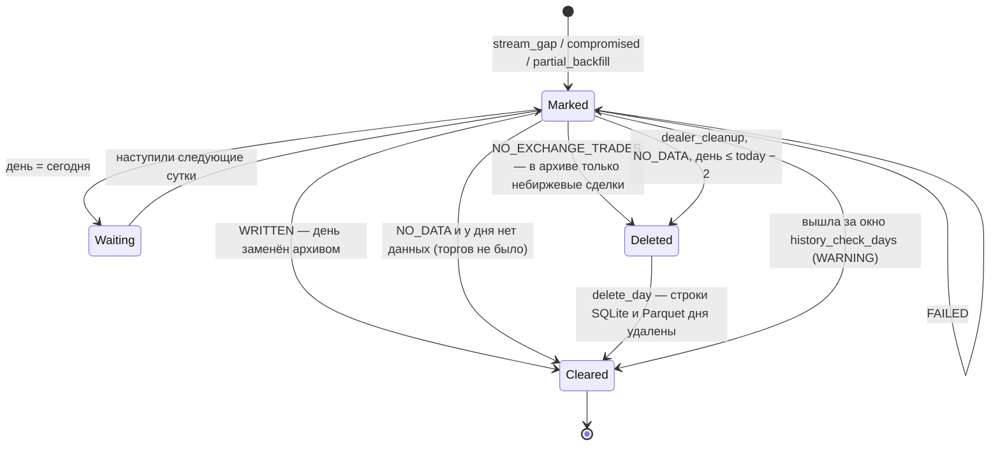

# 6. Догрузка и перекачка истории

Модуль: `autoload.py`, точка входа `run_backfill()`. Выполняется в составе
обслуживания хранилища (`main.run_maintenance`): при старте процесса, до
запуска коллекторов, и ежесуточно по расписанию `archiver.*` при работающих
коллекторах. Отдельным проходом `cleanup=True` в фоне выполняется однократная
чистка от дилерских сделок (6.3.1). Сохраняются только биржевые сделки
([SPEC-0002](specs/0002-exchange-only-trades.md)). Внешние контракты:
[contracts/openapi/t-invest-rest.openapi.yaml](contracts/openapi/t-invest-rest.openapi.yaml).

## 6.1. Алгоритм

## 6.2. Отсутствующие дни

`missing_days(config, repo)` перебирает `offset = 0 … history_check_days − 1`
и возвращает дни `today − offset`, отсутствующие в `repo.available_days()`
(объединение дней SQLite и имён Parquet-файлов).

- Сегодняшний день входит в проверку.
- Выходные и праздники без торгов каждый раз запрашиваются повторно (архив
  отвечает 404, данные не пишутся).

## 6.3. Отметки для перекачки

Неполный день отмечается в таблице `days_to_refresh` репозитория
инструмента и заменяется данными официального архива целиком.

| Причина | Кто отмечает | Событие |
|---------|--------------|---------|
| `stream_gap` | коллектор (через консьюмер) | Стрим открыт: сделки до открытия не получены |
| `compromised` | — (устарела, SPEC-0005) | Ставилась при разрыве числовых `trade_id`; может встречаться в старых отметках |
| `partial_backfill` | догрузка | Сегодняшний день записан из `GetLastTrades` |
| `dealer_cleanup` | `schedule_dealer_cleanup` (однократно) | День сохранён до введения биржевого фильтра (SPEC-0002 G-4) |

`refresh_days(config, repo)` возвращает отмеченные дни раньше сегодняшнего
внутри окна `history_check_days`, кроме отметок `dealer_cleanup`;
`refresh_days(config, repo, cleanup=True)` — только `dealer_cleanup`, без
ограничения окном, от новых дней к старым. Сегодняшний день ждёт следующего
обслуживания: его архива ещё нет. Отметки старше окна снимаются с
предупреждением. Если отмеченный день одновременно отсутствует, он
обрабатывается как отсутствующий.

Поскольку стрим открывается каждые сутки (при старте или после ночного
обслуживания), фактически каждый торговый день один раз перекачивается из
официального архива. Это добавляет одну загрузку на инструмент в сутки.
Из-за неизвестного времени публикации архива перекачка может сдвинуться до
следующего обслуживания ([L-01](12-known-issues.md#l-01),
[L-02](12-known-issues.md#l-02)).

### 6.3.1. Чистка от дилерских сделок

До SPEC-0002 стрим и архив сохраняли и дилерские сделки. Чистка однократная:

1. После запуска коллекторов `main.run_dealer_cleanup` вызывает
   `schedule_dealer_cleanup(repo)` для каждого инструмента. Все прошедшие
   дни обоих хранилищ отмечаются `dealer_cleanup` (`override=True`
   перезаписывает другие причины). Флаг `spec0002_dealer_cleanup_scheduled`
   в таблице `meta` не даёт отметить дни повторно. Сегодняшний день не
   отмечается: он уже отмечен `stream_gap` и будет перекачан ночным
   обслуживанием.
2. Проходы `run_backfill(cleanup=True)` перекачивают отмеченные дни с
   биржевым фильтром. Между проходами — пауза `CLEANUP_RETRY_SEC` (30 мин),
   не больше `CLEANUP_MAX_PASSES` (48) за запуск; остаток продолжится при
   следующем запуске.
3. Чистка идёт в фоне (при ~28 файлах архива в минуту тысячи дней заняли бы
   часы). Ограничитель темпа архива (`autoload.archive_gate()`) один на
   процесс. Чистка берёт `maintenance_lock` на каждый день, а обслуживание —
   на весь прогон, поэтому архиватор не пишет Parquet дня одновременно с
   его перекачкой.

## 6.4. Резолюция инструментов

| Данные | Основной путь (SDK установлен) | Фолбэк (без SDK) | При неудаче |
|--------|--------------------------------|------------------|-------------|
| FIGI акции | `instruments.find_instrument(query=id, instrument_kind=SHARE)` | `POST …/InstrumentsService/FindInstrument` `{query, instrument_kind: 2}` | `None` |
| Справочник фьючерсов | `instruments.futures(instrument_status=INSTRUMENT_STATUS_ALL)` | `POST …/InstrumentsService/Futures` `{instrument_status: 2}` | пустой словарь |

Правило выбора акции (`_pick_share`): точное совпадение `ticker == id`,
среди совпадений приоритет класса `TQBR`, затем `SPBXM`; без точного
совпадения — `None`.

Справочник запрашивается со статусом `ALL`, чтобы в нём были истёкшие
контракты: для прошедших дней непрерывного фьючерса нужен контракт,
активный в тот день.

FIGI для сегодняшнего дня (`current_figi`):

| `type` | Источник FIGI |
|--------|---------------|
| `share` | Результат резолюции акции |
| `futures_contract` | `figi` контракта `id` из справочника |
| `continuous_futures` | `figi` контракта `nearest_contract(instrument, futures, today)` |

## 6.5. Источник данных по дню

| День | Источник | Транспорт |
|------|----------|-----------|
| `day ≥ today` | `MarketDataService.GetLastTrades(instrument_id=FIGI)`, без `from`/`to` | gRPC (SDK), иначе REST |
| `day < today` | `GET /history-trades/{YYYY-MM-DD}?instrumentId={key}` | HTTPS (`aiohttp`) |

`GetLastTrades` возвращает лишь последние сделки; такой день отмечается
`partial_backfill` ([L-03](12-known-issues.md#l-03)). REST-запрос передаёт
`trade_source = TRADE_SOURCE_EXCHANGE`. Обёртка SDK 1.49 этого параметра не
принимает, поэтому небиржевые сделки отбрасываются по полю `trade_source`
каждой сделки ([L-11](12-known-issues.md#l-11)).

Итог догрузки дня — `BackfillResult`:

| Значение | Когда |
|----------|-------|
| `WRITTEN` | Данные получены и записаны |
| `NO_DATA` | Источник ответил, сделок за день нет: архив 404 по всем ключам, пустой CSV, нет строк этого дня, REST `GetLastTrades` 404 |
| `NO_EXCHANGE_TRADES` | Архив опубликован, но все его строки небиржевые: при перекачке день удаляется из хранилищ |
| `FAILED` | FIGI/ключ не определён, сетевая ошибка, иной HTTP-статус, повреждённый gzip, исчерпан лимит 429 |

## 6.6. Ключи архива и непрерывные фьючерсы

| `type` | Кандидаты `instrumentId` (по порядку) | Источник `class_code` |
|--------|---------------------------------------|-----------------------|
| `share` | `{id}_TQBR`, `{id}_SPBXM` | константа `ARCHIVE_CLASS_CANDIDATES` |
| `futures_contract` | `{id}_{class_code}` | справочник фьючерсов, иначе `SPBFUT` |
| `continuous_futures` | `{ticker}_{class_code}` контракта `nearest_contract(instrument, futures, day)` | справочник фьючерсов; нет контракта — ключей нет, итог `FAILED` |

`nearest_contract` — общее правило для стрима и догрузки: контракты этого
базового актива (шаблон `{id}{код месяца}{год}`) с экспирацией в день `day`
или позже, из них — с минимальной экспирацией.

Пример: справочник `{SRU6: 2026-09-17, SiU6: 2026-09-18, SiZ6: 2026-12-17}`,
инструмент `Si`.

| `day` | Ключ |
|-------|------|
| 2026-09-01 | `SiU6_SPBFUT` (`SRU6` — другой актив, не рассматривается) |
| 2026-09-18 | `SiU6_SPBFUT` |
| 2026-09-19 | `SiZ6_SPBFUT` |
| 2027-01-01 | ключей нет |

## 6.7. Обработка ответов `history-trades`

| Ответ | Действие | Итог |
|-------|----------|------|
| `200` | Если первые байты `1f 8b` — `gzip.decompress`; разбор CSV; строки с `TRADE_SOURCE` ≠ `EXCHANGE` отбрасываются (`_exchange_only`) | `WRITTEN`, `NO_DATA` или `NO_EXCHANGE_TRADES` |
| `404` | Перейти к следующему ключу-кандидату | все ключи 404 → `NO_DATA` |
| `429` | Ждать `Retry-After` (по умолчанию 60 с), до 3 попыток | исчерпано → `FAILED` |
| Иной статус / сетевая ошибка (`aiohttp.ClientError`) | Без повтора | `FAILED` |
| Повреждённый gzip | — | `FAILED` |

## 6.8. Ограничение темпа

| Механизм | Значение | Область |
|----------|----------|---------|
| `Semaphore(MAX_BACKFILL_CONCURRENCY)` | 4 | одновременно обрабатываемые дни (все источники) |
| `_RateGate(60 / ARCHIVE_MAX_PER_MIN)` | интервал ≈ 2,14 с (≤ 28 запросов/мин) | каждый HTTP-запрос к `history-trades`, включая повторы; один экземпляр на процесс (`archive_gate()`), общий для обслуживания и чистки |
| `ARCHIVE_ATTEMPTS` | 3 | попытки на ключ при 429 |
| Таймаут HTTP | 120 с (резолюция — 30 с) | каждый запрос |

## 6.9. Маппинг строки архива на строку тика

Входной формат — CSV с заголовком
`TRADE_TS,TICKER_CC,DIRECTION,PRICE,QUANTITY,TRADE_SOURCE,INSTRUMENT_UID`
(схема строки: [history-trade-record.schema.json](contracts/schemas/history-trade-record.schema.json)).
Колонки ищутся по подстроке в имени заголовка без учёта регистра; BOM
допускается.

| Поле тика | Колонка CSV (поиск по подстроке, по приоритету) | Преобразование |
|-----------|-------------------------------------------------|----------------|
| `ticker` | — | `instrument.storage_name` |
| `timestamp` | `trade_ts` → `time` → `timestamp` | `pd.to_datetime(utc=True, format="ISO8601")` — формат определяется для каждой строки; нераспознанные строки отбрасываются |
| `price` | `price` | `float` |
| `volume` | `quantity` → `volume` | `int` |
| `direction` | `direction` | `parse_direction`; колонки нет → `UNKNOWN` |
| `trade_id` | `tradeid` → `trade_id` | нет колонки/пусто → `s{YYYYmmddHHMMSSffffff}_{idx}` |
| — | `trade_source` | только отбор: строки с явным небиржевым источником отбрасываются; колонки нет или пусто — строка принимается |
| — | `TICKER_CC`, `INSTRUMENT_UID` | не сохраняются |

Строки с ошибкой преобразования числа пропускаются. После разбора остаются
только строки, у которых дата `timestamp` (UTC) совпадает с запрошенным днём.

## 6.10. Маппинг `GetLastTrades` на строку тика

| Поле тика | REST JSON (`trades[]`) | SDK `Trade` | Преобразование |
|-----------|------------------------|-------------|----------------|
| `ticker` | — | — | `instrument.storage_name` |
| `timestamp` | `time` (RFC 3339) | `time: datetime` | `_as_utc`; нет поля → строка пропускается; нераспознанная строка → `now(UTC)` |
| `price` | `price.units` (int64 как строка) + `price.nano` | `price.units + price.nano` | `units + nano / 1e9` |
| `volume` | `quantity` (int64 как строка) | `quantity` | `int`, по умолчанию 0 |
| `direction` | `direction` (`TRADE_DIRECTION_*`) | `direction` (`IntEnum`) | `parse_direction`, как в [5.4](05-realtime-collection.md#54-маппинг-сделки-на-tick-_to_dto) |
| `trade_id` | `trade_id` / `tradeId` | — | иначе пустая строка |
| — | `trade_source` / `tradeSource` | `trade_source` (`IntEnum`) | только отбор: явный небиржевой источник → строка отбрасывается |

## 6.11. Маршрутизация записи

`_target_for_day(day)`: `day ≥ today − 7` → SQLite, иначе Parquet. Граница
совпадает с границей очистки архиватора (инвариант A9).

| Режим | SQLite (`day ≥ today − 7`) | Parquet (`day < today − 7`) |
|-------|----------------------------|-----------------------------|
| Догрузка отсутствующего дня | `insert_ticks` | `write_parquet` |
| Перекачка отмеченного дня | `replace_hot_day` (удаление строк дня и вставка в одной транзакции); существующий Parquet дня перезаписывается | `write_parquet` (перезапись) |
