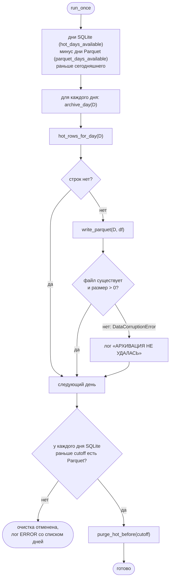

# 7. Архивация и удержание данных

Модуль: `archiver.py` (`DataArchiver`, `run_archiver`,
`seconds_until_next_run`).

## 7.1. Когда выполняется

Архивация — второй этап обслуживания хранилища (`main.run_maintenance`),
после догрузки:

| Запуск | Кто вызывает | Состояние коллекторов |
|--------|--------------|-----------------------|
| При старте процесса | `main.startup_maintenance` (в фоне) | уже работают, стрим открыт (SPEC-0011 G-5) |
| Ежесуточно в `archiver.run_hour_utc:run_minute_utc` UTC (по умолчанию 00:05) | `main.run_scheduler` | работают; SQLite в режиме WAL допускает параллельную работу |

`seconds_until_next_run(now, schedule)` возвращает время до ближайшего
запуска строго в будущем: в 00:05:00 следующий запуск — через 24 ч.

Инструменты обрабатываются параллельно (`asyncio.gather`), независимо друг
от друга. После ночного обслуживания коллекторы непрерывных фьючерсов
переподключаются, чтобы заново выбрать активный контракт.

## 7.2. Алгоритм `run_once`

`archive_day(day)` только записывает и проверяет Parquet и возвращает
`True`/`False`; SQLite не изменяет. Удаляет строки только `run_once`, после
проверки наличия Parquet для каждого удаляемого дня (инвариант A8).

Сегодняшний день не архивируется. День, уже имеющий Parquet, повторно не
архивируется: после архивации строки прошедшего дня в SQLite меняет только
перекачка, а она сама перезаписывает Parquet
([6.11](06-history-backfill.md#611-маршрутизация-записи)).

## 7.3. Граница удержания

`_hot_purge_cutoff() = today − HOT_RETENTION_DAYS` (полночь, `HOT_RETENTION_DAYS = 7`).
Удаляются строки со строковым `timestamp < cutoff`.

Пример для запуска 2026-10-12 в 00:05 UTC:

| Величина | Значение |
|----------|----------|
| Архивируются | все дни SQLite до 2026-10-11 включительно без Parquet-файла |
| `cutoff` | `2026-10-05T00:00:00+00:00` |
| Остаётся в SQLite | 2026-10-05 … 2026-10-12 (8 календарных дат, включая текущую) |
| Удаляется из SQLite | всё раньше 2026-10-05, если у этих дней есть Parquet |

Граница проходит по полуночи, а не по `now − 7 суток`, потому что догрузка
направляет день `today − 7` в SQLite (`_target_for_day`). При границе
`now − 7d` этот день был бы частично удалён.

## 7.4. Результаты

| Ситуация | Parquet | Очистка SQLite |
|----------|---------|----------------|
| Все прошедшие дни заархивированы | создан для каждого нового дня | выполняется |
| `DataCorruptionError` для дня раньше `cutoff` | некорректный или отсутствует | отменяется целиком |
| `DataCorruptionError` для дня в окне 7 дней | некорректный или отсутствует | выполняется (этот день не удаляется); архивация повторится при следующем запуске |
| Иное исключение (I/O, SQLite) | — | не выполняется; `run_maintenance` логирует `Ошибка сверки архиватора` |
