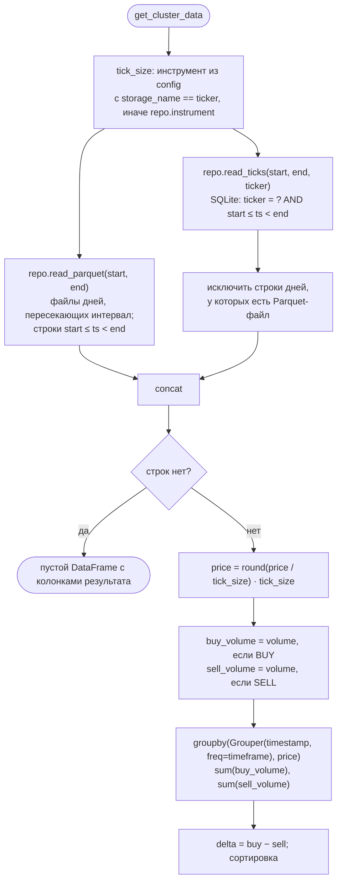

# 8. Чтение данных: footprint

Модуль: `reader.py`, функция `get_cluster_data()`. Это единственный
публичный интерфейс для потребителя (торгового робота); вызывается
in-process.

## 8.1. Сигнатура

```python
def get_cluster_data(
    config: AppConfig,
    repo: MarketDataRepository,
    ticker: str,
    start_time: datetime,
    end_time: datetime,
    timeframe: str = "5min",
) -> pd.DataFrame
```

| Параметр | Тип | Описание |
|----------|-----|----------|
| `config` | `AppConfig` | Используется для поиска `tick_size` по `storage_name` |
| `repo` | `MarketDataRepository` | Репозиторий инструмента; Parquet читается из его каталога |
| `ticker` | `str` | Ключ хранения (`storage_name`): `SBER`, `Si_CONTINUOUS` |
| `start_time` | `datetime` | Начало интервала включительно; naive трактуется как UTC |
| `end_time` | `datetime` | Конец интервала, не включая; naive трактуется как UTC |
| `timeframe` | `str` | Частота pandas (`1min`, `5min`, `15min`, `1h`, …) |

Пример:

```python
from datetime import UTC, datetime
from cluster_source.config import AppConfig
from cluster_source.database import MarketDataRepository
from cluster_source.reader import get_cluster_data

config = AppConfig.from_yaml("config.yaml")
si = next(i for i in config.instruments if i.storage_name == "Si_CONTINUOUS")
repo = MarketDataRepository(config.storage_root, si)
df = get_cluster_data(
    config,
    repo,
    "Si_CONTINUOUS",
    start_time=datetime(2026, 10, 12, 7, 0, tzinfo=UTC),
    end_time=datetime(2026, 10, 12, 8, 0, tzinfo=UTC),
    timeframe="5min",
)
```

## 8.2. Результат

Каждая строка — ячейка «интервал × уровень цены». JSON Schema строки:
[contracts/schemas/footprint-row.schema.json](contracts/schemas/footprint-row.schema.json).

| Колонка | Тип pandas | Описание |
|---------|------------|----------|
| `timestamp` | `datetime64[*, UTC]` | Левая граница интервала `timeframe` |
| `price` | `float64` | Цена, округлённая до `tick_size` |
| `buy_volume` | `int64` | Сумма `volume` сделок `BUY` |
| `sell_volume` | `int64` | Сумма `volume` сделок `SELL` |
| `delta` | `int64` | `buy_volume − sell_volume` |

Сортировка: `timestamp`, затем `price` по возрастанию. Ячейки без сделок
не выводятся. Сделки `UNKNOWN` не входят ни в одну сторону; ячейка только с
такими сделками выводится с нулевыми объёмами
([L-06](12-known-issues.md#l-06)).

Если в интервале нет сделок, возвращается пустой `DataFrame` с колонками
`timestamp, price, buy_volume, sell_volume, delta`.

Пример результата (`tick_size = 1.0`, `timeframe = "5min"`):

| timestamp | price | buy_volume | sell_volume | delta |
|-----------|-------|------------|-------------|-------|
| 2026-10-12 07:00:00+00:00 | 96512.0 | 40 | 15 | 25 |
| 2026-10-12 07:00:00+00:00 | 96513.0 | 3 | 22 | −19 |
| 2026-10-12 07:05:00+00:00 | 96513.0 | 11 | 11 | 0 |

## 8.3. Алгоритм



| Шаг | Правило | Обоснование |
|-----|---------|-------------|
| Фильтр Parquet | Файлы дней от `midnight(start)` до `end`; строки по точному интервалу `[start, end)` | |
| Фильтр SQLite | По `ticker` и точному интервалу `[start, end)` | |
| Выбор источника по дню | Если у дня есть Parquet-файл, берётся Parquet, строки SQLite этого дня отбрасываются | Parquet — архивная копия SQLite или перекачанный официальный архив; сделки не учитываются дважды, а реальные одинаковые сделки не схлопываются (дедупликации нет) |
| Округление | Половина шага — банковское округление (`Series.round`) | `tick_size` из конфигурации |

## 8.4. Конкурентный доступ

Чтение безопасно во время работы коллектора: SQLite в режиме WAL позволяет
читателям видеть последнее зафиксированное состояние, не блокируя запись.
Тики появляются в SQLite с задержкой до `flush_interval_sec`. Строки дня в
SQLite при перекачке заменяются одной транзакцией, поэтому читатель не
видит день пустым или задвоенным. Parquet-файл дня перезаписывается
обслуживанием хранилища (догрузка, перекачка, архивация).
